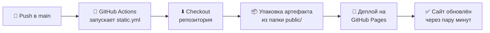

# 🌤️ Weather App (Hello Static)

> **Прогноз погоды по городам мира** — учебный проект команды «Hello Static», написанный на чистом HTML, CSS и JavaScript. Без фреймворков, без бандлеров, без лишней магии. Каждый push в `main` автоматически деплоится на GitHub Pages через GitHub Actions.

[](https://github.com/lehmanmihail-debug/hello-static-debug/actions/workflows/static.yml)
[](https://lehmanmihail-debug.github.io/hello-static-debug/)
[](https://github.com/lehmanmihail-debug/hello-static-debug)
[](https://github.com/lehmanmihail-debug/hello-static-debug/graphs/contributors)

<br>


---

## 📑 Содержание

- [📖 О проекте](#-о-проекте)
- [✨ Возможности](#-возможности)
- [🌐 Демо](#-демо)
- [🧰 Технологический стек](#-технологический-стек)
- [🚀 Быстрый старт](#-быстрый-старт)
- [🧪 Проверка кода](#-проверка-кода)
- [📁 Структура проекта](#-структура-проекта)
- [⚙ CI/CD пайплайн](#-cicd-пайплайн)
- [👥 Команда](#-команда)
- [🤝 Как внести вклад](#-как-внести-вклад)
- [🚧 Roadmap](#-roadmap)
- [❓ FAQ](#-faq)
- [🛟 Решение проблем](#-решение-проблем)
- [🔗 Полезные ссылки](#-полезные-ссылки)
- [📄 Лицензия](#-лицензия)

---

## 📖 О проекте

**Weather App** — это статический сайт, который показывает текущую погоду в любом городе мира. Пользователь вводит название города или выбирает один из быстрых вариантов (Москва, Санкт-Петербург, Лондон), а приложение обращается к открытому API [Open-Meteo](https://open-meteo.com/) и выводит температуру, ощущаемую температуру, скорость ветра и влажность. Данные приходят в реальном времени, API бесплатный и не требует регистрации.

Проект создан в рамках учебной командной работы и преследует несколько целей. Во-первых, это практика совместной разработки: задачи распределены между пятью участниками, код проходит ревью тимлида, а работа ведётся через ветки и pull request'ы. Во-вторых, это освоение CI/CD — настройке автоматического деплоя на GitHub Pages через GitHub Actions. В-третьих, мы сознательно отказались от фреймворков и сборщиков: только ванильный HTML, CSS и JavaScript, чтобы понять, как всё работает «под капотом».

Код проекта проверяется тремя линтерами — `html-validate`, `stylelint` и `ESLint`, — поэтому все файлы соответствуют единому стилю. Сайт не требует сборки: папка `public/` целиком и является приложением.

---

## ✨ Возможности

- 🌡️ **Текущая температура** и «ощущается как» — мгновенно после запроса
- 💨 **Скорость ветра** и 💧 **влажность** — всё самое важное на одном экране
- 🔎 **Поиск любого города мира** — просто введите название в поле ввода
- ⚡ **Кнопки быстрого выбора** — Москва, СПб и Лондон в один клик
- ⌨️ **Работа с клавиатуры** — можно нажать Enter вместо кнопки
- 🇷🇺 **Русский интерфейс** — понятный и минималистичный
- 📱 **Адаптивная вёрстка** — корректно отображается на мобильных устройствах
- 🔄 **Автодеплой** — изменения на сайте появляются сразу после мержа в `main`

---

## 🌐 Демо

Сайт развёрнут на **GitHub Pages** и доступен по ссылке:

> ### 👉 [https://lehmanmihail-debug.github.io/hello-static-debug/](https://lehmanmihail-debug.github.io/hello-static-debug/)

При загрузке страницы автоматически показывается погода в Москве — так удобно сразу увидеть приложение в действии. Если вы хотите проверить погоду в своём городе, просто начните вводить его название.

Быстрые города, доступные в один клик:

| Город | Как найти |
|-------|-----------|
| 🏙 Москва | Кнопка «Москва» или ввод в поле |
| 🌉 Санкт-Петербург | Кнопка «СПб» или ввод в поле |
| 🎡 Лондон | Кнопка «Лондон» или ввод в поле |

---

## 🧰 Технологический стек

| Слой | Технологии | Описание |
|------|------------|----------|
| 🧱 Разметка | **HTML5** | Семантическая вёрстка, единственный экран — `public/index.html` |
| 🎨 Стилизация | **CSS3** | Адаптивная вёрстка без препроцессоров, `public/style.css` |
| ⚙ Логика | **JavaScript (ES6+)** | Работа с DOM и `fetch` к API, `public/script.js` |
| 🌍 Данные | **Open-Meteo API** | Бесплатный API погоды, не требует API-ключа |
| ✅ Качество кода | **ESLint · Stylelint · html-validate** | Три линтера следят за единым стилем |
| 🤖 CI/CD | **GitHub Actions** | Workflow `static.yml`: сборка и деплой при каждом push в `main` |
| ☁ Хостинг | **GitHub Pages** | Бесплатный статический хостинг из коробки |
| 📦 Зависимости | **npm** | Только dev-зависимости для линтеров — в рантайме их нет |

---

## 🚀 Быстрый старт

### Требования

- 🌐 Любой современный браузер (Chrome, Firefox, Edge, Safari)
- 🟢 Node.js 18+ и npm — **только** если хотите запускать линтеры

### Вариант 1 — просто открыть сайт

Сборка не нужна! Скачайте репозиторий и откройте `public/index.html` двойным кликом в браузере.

### Вариант 2 — клонировать репозиторий

```bash
# 1. Клонируем репозиторий
git clone https://github.com/lehmanmihail-debug/hello-static-debug.git

# 2. Переходим в папку проекта
cd hello-static-debug

# 3. Открываем public/index.html в браузере
#    (или перетащите файл в окно браузера)
```

### Как пользоваться приложением

1. Введите название города в поле ввода — например, **Москва** или **London**
2. Нажмите кнопку **«Узнать погоду»** (или клавишу **Enter**)
3. Сайт покажет температуру, погодные условия, скорость ветра и влажность
4. Либо воспользуйтесь кнопками быстрого выбора: **Москва**, **СПб**, **Лондон**

---

## 🧪 Проверка кода

Чтобы все файлы проекта соответствовали единому стилю, мы используем три линтера. Запустить их очень просто:

```bash
# 1. Устанавливаем dev-зависимости
npm install

# 2. Запускаем все проверки сразу
npm run lint
```

Можно запускать проверки по отдельности:

| Команда | Линтер | Что проверяет |
|---------|--------|---------------|
| `npm run lint:html` | **html-validate** | Валидность и семантика HTML-разметки |
| `npm run lint:css` | **Stylelint** | Качество и согласованность CSS (`--fix` исправляет часть проблем сам) |
| `npm run lint:js` | **ESLint** | Ошибки и code style в JavaScript-коде |
| `npm run lint` | все вместе | Полная проверка перед коммитом |

> 💡 **Совет:** запускайте `npm run lint` перед каждым pull request'ом — так ревью пройдет быстрее, а история коммитов останется чистой.

---

## 📁 Структура проекта

```
hello-static-debug/
├── .github/
│   └── workflows/
│       └── static.yml        # 🤖 GitHub Actions: автодеплой на GitHub Pages
├── public/                   # 🌐 Все файлы сайта (это и есть приложение)
│   ├── index.html            # 🧱 Разметка главной страницы
│   ├── style.css             # 🎨 Стили: сетка, карточки, адаптивность
│   ├── script.js             # ⚙ Логика: запросы к API, работа с DOM
│   └── favicon.svg           # 🖼 Иконка сайта (векторная)
├── .htmlvalidate.json        # ✅ Конфигурация HTML-валидатора
├── .stylelintrc.json         # ✅ Конфигурация CSS-линтера
├── eslint.config.js          # ✅ Конфигурация ESLint
├── package.json              # 📦 Скрипты и dev-зависимости
├── package-lock.json         # 🔒 Фиксация версий зависимостей
├── .gitignore                # 🚫 Что не попадает в git
└── README.md                 # 📘 Документация проекта (вы её читаете)
```

Проект намеренно не содержит папок `src`, `dist` или конфигов сборщиков: то, что лежит в `public/`, сразу готово к публикации.

---

## ⚙ CI/CD пайплайн

За автоматический деплой отвечает GitHub Actions workflow **`static.yml`**. Как только изменения попадают в ветку `main`, GitHub сам собирает сайт из папки `public/` и публикует его на GitHub Pages — ничего делать руками не нужно.



### Что происходит по шагам

1. **Триггер** — workflow запускается при каждом push в ветку `main`
2. **Checkout** — GitHub Actions забирает свежую версию кода из репозитория
3. **Артефакт** — в качестве источника публикации используется папка `public/`
4. **Деплой** — артефакт публикуется на GitHub Pages
5. **Результат** — сайт по ссылке выше обновлён (обычно занимает 1–2 минуты)

### Почему это удобно

- 🚫 **Никаких ручных деплоев** — забудьте про «залей файлы на сервер»
- 🔁 **Всегда актуальная версия** — сайт всегда соответствует `main`
- 📜 **История сборок** — каждая сборка видна во вкладке *Actions* с логами
- ↩ **Простая отладка** — если что-то сломалось, в логах Actions видно, когда именно

---

## 👥 Команда

Проект сделан пятью участниками учебной команды. У каждого — своя зона ответственности, чтобы никто не оставался в стороне и работа двигалась параллельно.

| Участник | Роль | Зона ответственности |
|----------|------|----------------------|
| **Лехман Михаил** | 👑 Тимлид | Постановка задач, архитектура проекта, code review, слияние pull request'ов в `main` |
| **Роденко Вениамин** | 🛠 Девопс | Настройка CI/CD: GitHub Actions workflow, GitHub Pages, конфигурация линтеров |
| **Чудин Артём** | 💻 Программист | HTML-разметка, структура страницы, семантика и доступность интерфейса |
| **Берендаков Андрей** | 💻 Программист | CSS-стили, адаптивная вёрстка, оформление карточек погоды |
| **Емельянов Павел** | 💻 Программист | JavaScript-логика: запросы к Open-Meteo, обработка ответов и ошибок, работа с DOM |

> 📊 **Отчёты контрибьюторов** — каждый участник фиксирует свой вклад в pull request'ах и коммитах, полную историю можно посмотреть во вкладке [Contributors](https://github.com/lehmanmihail-debug/hello-static-debug/graphs/contributors).

---

## 🤝 Как внести вклад

Мы — учебная команда, но работаем как «взрослые» разработчики: через ветки, конвенции и ревью. Если вы хотите помочь проекту, следуйте этому гайду.

### Пошаговая инструкция

```bash
# 1. Склонируйте репозиторий (или сделайте fork)
git clone https://github.com/lehmanmihail-debug/hello-static-debug.git
cd hello-static-debug

# 2. Создайте отдельную ветку для своей задачи
git checkout -b feature/my-awesome-feature

# 3. Внесите изменения и проверьте их линтерами
npm install
npm run lint

# 4. Сделайте коммит по конвенции (см. ниже)
git commit -m "feat: добавить геолокацию пользователя"

# 5. Отправьте ветку и откройте Pull Request
git push origin feature/my-awesome-feature
```

### Правила именования веток

| Префикс | Для чего | Пример |
|---------|----------|--------|
| `feature/` | Новая функциональность | `feature/dark-theme` |
| `fix/` | Исправление бага | `fix/wind-speed-rounding` |
| `docs/` | Документация | `docs/update-readme` |
| `refactor/` | Рефакторинг без изменения поведения | `refactor/split-script-js` |

### Конвенция коммитов

Мы используем [Conventional Commits](https://www.conventionalcommits.org/ru/) — первая строка коммита начинается с типа:

| Тип | Когда использовать | Пример |
|-----|--------------------|--------|
| `feat` | Новая функция | `feat: добавить прогноз на 5 дней` |
| `fix` | Исправление ошибки | `fix: округлить скорость ветра` |
| `docs` | Изменения документации | `docs: описать setup в README` |
| `style` | Форматирование, пробелы, стили | `style: переформатировать script.js` |
| `refactor` | Рефакторинг кода | `refactor: вынести fetch в отдельную функцию` |
| `chore` | Служебные задачи, зависимости | `chore: обновить eslint до 9.x` |

### Процесс ревью

1. ✅ Линтеры должны проходить без ошибок: `npm run lint`
2. 📝 PR должен иметь понятное описание: что сделано и зачем
3. 👑 Тимлид (Михаил) ревьюит код и решает, когда мержить в `main`
4. 🚀 После слияния CI/CD автоматически обновит сайт

> ⚠️ **Важно:** не коммитьте напрямую в `main` — только через pull request. Это защищает сайт от случайных поломок.

---

## 🚧 Roadmap

План развития проекта. Отмечайте выполненные задачи — это мотивирует!

| Статус | Задача | Приоритет |
|--------|--------|-----------|
| ✅ | Базовая вёрстка и стили главной страницы | — |
| ✅ | Получение погоды через Open-Meteo API | — |
| ✅ | Кнопки быстрого выбора городов (Москва, СПб, Лондон) | — |
| ✅ | Автодеплой на GitHub Pages через GitHub Actions | — |
| ✅ | Настройка линтеров: ESLint, Stylelint, html-validate | — |
| 🔲 | Прогноз на 3–5 дней вперёд | 🟠 Высокий |
| 🔲 | Определение города по геолокации пользователя | 🟠 Высокий |
| 🔲 | Избранные города с сохранением в `localStorage` | 🟡 Средний |
| 🔲 | Тёмная тема | 🟡 Средний |
| 🔲 | Анимации смены погодных условий | 🟢 Низкий |
| 🔲 | PWA-режим: работа офлайн и установка на телефон | 🟢 Низкий |
| 🔲 | Юнит-тесты для JS-логики | 🟢 Низкий |

---

## ❓ FAQ

**Почему при открытии сайта сразу показывается погода Москвы?**
Это демонстрационный режим: чтобы страница не встречала вас пустыми карточками, при загрузке автоматически подгружается погода Москвы. Просто введите свой город.

**Нужен ли API-ключ для Open-Meteo?**
Нет. [Open-Meteo](https://open-meteo.com/) — открытый и бесплатный API для некоммерческого использования, регистрация и ключи не требуются.

**Почему проект написан без React / Vue / бандлеров?**
Так задумано! Это учебный проект: цель — разобраться в основах веб-разработки и CI/CD, не пряча логику за фреймворками. Всё, что есть на сайте, написано руками.

**Куда деплоится сайт и как быстро обновляется?**
На GitHub Pages. После мержа в `main` сайт обновляется автоматически — обычно в течение одной-двух минут.

**Я нашёл баг, куда писать?**
Откройте [issue](https://github.com/lehmanmihail-debug/hello-static-debug/issues) в репозитории или напишите тимлиду — разберёмся.

---

## 🛟 Решение проблем

<details>
<summary><b>Команда npm не найдена / линтеры не запускаются</b></summary>

Проверьте, что Node.js установлен: `node --version` (нужна версия 18+). Если не установлен — скачайте с [nodejs.org](https://nodejs.org/). Перед запуском линтеров обязательно выполните `npm install` — без него dev-зависимостей нет.
</details>

<details>
<summary><b>Сайт не обновился после push в main</b></summary>

Подождите 1–2 минуты — деплой занимает время. Затем обновите страницу с очисткой кеша: `Ctrl+F5` (Windows) или `Cmd+Shift+R` (macOS). Проверьте вкладку [Actions](https://github.com/lehmanmihail-debug/hello-static-debug/actions): там видно, завершилась ли сборка и нет ли ошибок.
</details>

<details>
<summary><b>Город не находится</b></summary>

Попробуйте другое написание — например, английскую транслитерацию (Moscow вместо Москва). Убедитесь, что нет опечаток и лишних пробелов.
</details>

<details>
<summary><b>ESLint ругается на мой код в PR</b></summary>

Запустите `npm run lint:js` локально — ESLint покажет файл и строку. Часть проблем (отступы, кавычки) линтеры исправляют сами или подсказывают формулировку. Исправьте замечания и добавьте commit по конвенции.
</details>

---

## 🔗 Полезные ссылки

- 🌐 [Живое демо проекта](https://lehmanmihail-debug.github.io/hello-static-debug/) — наш сайт на GitHub Pages
- 🌍 [Open-Meteo](https://open-meteo.com/) — источник данных о погоде, бесплатный API без ключей
- 📚 [MDN Web Docs](https://developer.mozilla.org/ru/) — справочник по HTML, CSS и JavaScript
- 🤖 [Документация GitHub Actions](https://docs.github.com/ru/actions) — как устроены workflow-файлы
- ☁ [Документация GitHub Pages](https://docs.github.com/ru/pages) — про статический хостинг
- ✅ [Conventional Commits](https://www.conventionalcommits.org/ru/) — конвенция коммитов, которой мы следуем

---

## 📄 Лицензия

Проект создан в **учебных целях** командой «Hello Static». Код можно свободно изучать и использовать как пример учебного проекта. Если хотите переиспользовать его в своей работе — просто сошлитесь на этот репозиторий.

---

<div align="center">

**Weather App (Hello Static)** — сделано с ❤️ учебной командой из 5 человек

[🌐 Открыть демо](https://lehmanmihail-debug.github.io/hello-static-debug/) · [🤖 CI/CD](https://github.com/lehmanmihail-debug/hello-static-debug/actions) · [🐛 Сообщить о баге](https://github.com/lehmanmihail-debug/hello-static-debug/issues)

*Deployed with ❤️ to GitHub Pages*
 
 
</div>