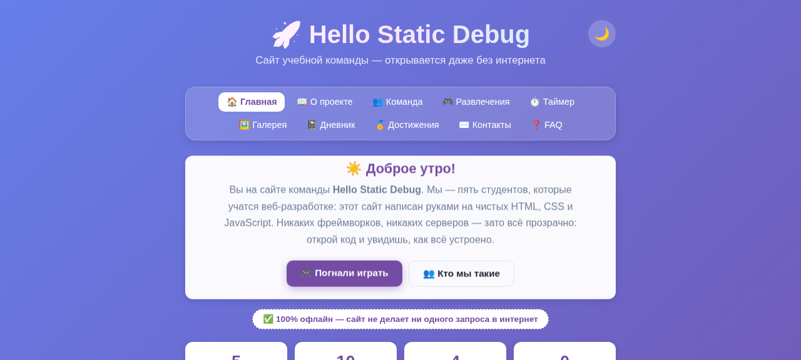
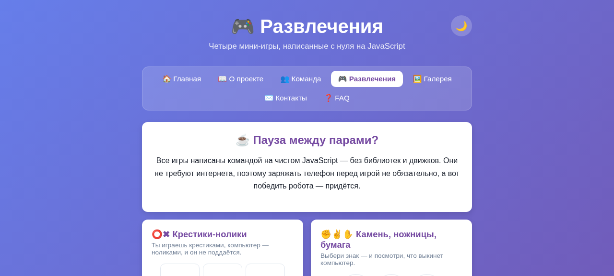
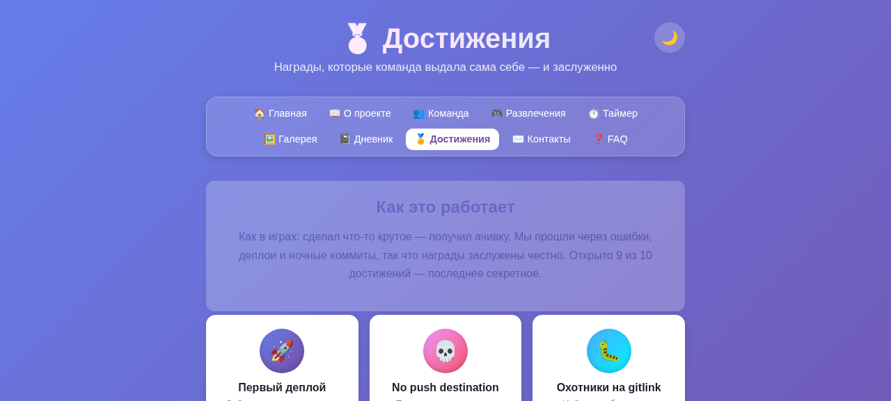
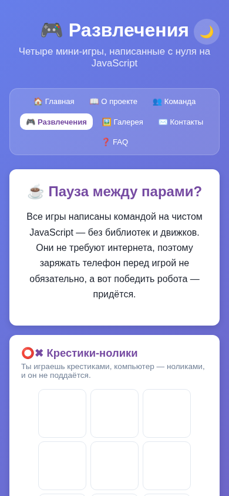

<div align="center">

# 🚀 Hello Static Debug

### Сайт команды, который работает всегда

**10 страниц · 4 мини-игры · Помодоро-таймер · 0 запросов к API**

Учебный командный проект: офлайн-сайт на чистом HTML, CSS и JavaScript.
Открывается двойным кликом по файлу — интернет не нужен вообще.

[](https://github.com/lehmanmihail-debug/hello-static-debug/actions/workflows/static.yml)
[](https://lehmanmihail-debug.github.io/hello-static-debug/)
[](https://github.com/lehmanmihail-debug/hello-static-debug)
[](https://github.com/lehmanmihail-debug/hello-static-debug/graphs/contributors)

<br>


</div>

---

## 📑 Содержание

- [📖 О проекте](#-о-проекте)
- [📴 Почему сайт работает без интернета](#-почему-сайт-работает-без-интернета)
- [🖼️ Скриншоты](#-скриншоты)
- [🗺 Страницы сайта](#-страницы-сайта)
- [🎮 Мини-игры](#-мини-игры)
- [⏱ Помодоро-таймер](#-помодоро-таймер)
- [📓 Дневник и достижения](#-дневник-и-достижения)
- [🚀 Быстрый старт](#-быстрый-старт)
- [📁 Структура проекта](#-структура-проекта)
- [🧰 Технологический стек](#-технологический-стек)
- [🔧 Настройка под себя](#-настройка-под-себя)
- [⚙ CI/CD пайплайн](#-cicd-пайплайн)
- [🛟 Решение проблем с CI/CD](#-решение-проблем-с-cicd)
- [👥 Команда](#-команда)
- [📜 История проекта](#-история-проекта)
- [🤝 Как внести вклад](#-как-внести-вклад)
- [↩ Откат изменений](#-откат-изменений)
- [🚧 Roadmap](#-roadmap)
- [❓ FAQ](#-faq)
- [🩹 Решение проблем](#-решение-проблем)
- [🔗 Полезные ссылки](#-полезные-ссылки)
- [📄 Лицензия](#-лицензия)

---

## 📖 О проекте

**Hello Static Debug** — это сайт учебной команды из пяти человек, и он написан так, что не может сломаться из-за интернета: ни одного запроса к API, ни одной внешней зависимости, ни одного фреймворка. Только ванильные HTML, CSS и JavaScript. Откройте `public/index.html` двойным кликом из проводника — и сайт полностью работает: меню, игры, таймер, тёмная тема, формы. Это принципиальное решение, а не ограничение: после того как погодный API однажды не загрузился в учебном классе, мы решили, что сайт, который работает всегда, лучше сайта, который иногда показывает погоду.

Несмотря на «детский» стек, внутри много настоящей инженерии. В крестиках-ноликах компьютер играет по правилам: сначала ищет выигрышный ход, потом блокирует ваш, потом забирает центр. Тёмная тема переключается одним `data-атрибутом` на `<html>` и запоминается в `localStorage`. Копирование контактов идёт через современный Clipboard API с ретро-фолбэком на `execCommand`. Форма обратной связи собирает письмо и открывает почтовый клиент через `mailto:` — бэкенд не нужен. Каждый такой приём — маленький урок, который мы изучили и задокументировали.

Проект создан в рамках учебной командной работы и тренирует то, что попросит будущий работодатель: работу с Git и ветками, pull request'ы и ревью, автоматический деплой через GitHub Actions и дисциплину линтеров — `html-validate`, `stylelint` и `ESLint` проверяют каждый коммит. Сайт не требует сборки: папка `public/` целиком и является приложением, а CI просто берёт её и выкладывает на GitHub Pages.

> 💡 **Главный принцип проекта:** сайт, который всегда работает, лучше сайта, который иногда работает.

---

## 📴 Почему сайт работает без интернета

Когда-то это был погодный сайт на [Open-Meteo API](https://open-meteo.com/). Потом API перестал открываться в учебной сети, и каждый предпросмотр заканчивался плашкой «Не удалось загрузить данные». Мы могли бы долго бороться с прокси и CORS, но приняли стратегическое решение: **убрать зависимость полностью**.

Что это дало на практике:

- **Ноль сетевых ошибок.** Плашки «Не удалось загрузить данные» невозможны в принципе — данных, которые грузятся из сети, просто нет.
- **Мгновенная загрузка.** Всё содержимое уже в файлах: сайт открывается быстрее, чем успевает моргнуть курсор.
- **Работа где угодно.** В аудитории без Wi-Fi, в метро, в самолёте — неважно, соединения нет, а сайт есть.
- **Прозрачный код.** Каждая функция читается от начала до конца, не прыгая по колбэкам запросов. Идеально для учебного проекта.
- **Простая проверка.** Открыть файл двойным кликом — это весь тест-план по окружению. Работает локально — работает и на GitHub Pages.

---

## 🖼️ Скриншоты

| Главная | Развлечения |
| --- | --- |
|  |  |

| Достижения | Мобильная версия |
| --- | --- |
|  |  |

> 📸 Все скриншоты лежат в папке [`previews/`](previews/) — там же есть страницы галереи, контактов, таймера и дневника.

---

## 🗺 Страницы сайта

Сайт вырос из одной страницы до десяти — и каждая живёт в отдельном файле:

| # | Страница | Файл | Что внутри |
|---|----------|------|------------|
| 1 | 🏠 Главная | `index.html` | Приветствие по времени суток, статистика проекта, карточки разделов, цитата дня |
| 2 | 📖 О проекте | `about.html` | Зачем сайт, почему офлайн, как устроен, на чём написан |
| 3 | 👥 Команда | `team.html` | 5 карточек участников с ролями, биографиями и градиентными аватарами |
| 4 | 🎮 Развлечения | `games.html` | Четыре мини-игры на чистом JavaScript — см. раздел ниже |
| 5 | ⏱ Таймер | `timer.html` | Помодоро-таймер 25/5/15 минут с прогресс-баром и счётчиком помидоров |
| 6 | 🖼 Галерея | `gallery.html` | 9 мем-плиток команды и случайный «факт дня» |
| 7 | 📓 Дневник | `blog.html` | Честная история разработки: 6 этапов от `hello world` до 10 страниц |
| 8 | 🏅 Достижения | `achievements.html` | 9 ачивок команды (+1 секретная, вы её уже почти нашли) |
| 9 | ✉ Контакты | `contacts.html` | Почта, Telegram, GitHub — с копированием в один клик и формой связи |
| 10 | ❓ FAQ | `faq.html` | 8 вопросов-ответов: как запустить, как задеплоить, зачем всё это |

Все страницы связаны общим меню, общей тёмной темой и общим футером. Навигация подсвечивает текущую страницу, а на мобильных перестраивается в компактную сетку.

---

## 🎮 Мини-игры

Все игры написаны с нуля на JavaScript — без библиотек, движков и, конечно, без интернета. Логика каждой лежит в [`public/games.js`](public/games.js):

| Игра | Как играть | Что под капотом |
|------|-----------|-----------------|
| ⭕✖ **Крестики-нолики** | Вы — крестики, компьютер — нолики. Побеждает линия из трёх | ИИ из трёх правил: выиграть → заблокировать игрока → захватить центр. Счёт побед/ничьих |
| ✊✌✋ **Камень, ножницы, бумага** | Выберите знак, компьютер выберет свой | Таблица соответствий `RPS_BEATS`, случайный выбор соперника, счёт побед/поражений |
| 🔢 **Угадай число** | Компьютер загадал число от 1 до 100 — найдите его | Генерация числа, валидация ввода через `<form>`, счётчик попыток, подсказки «больше/меньше» |
| 🧠 **Викторина** | 6 вопросов об IT и веб-разработке | Массив вопросов с индексами правильных ответов, прогресс-бар, автоматический подсчёт результата |

> 🤖 Робот в крестиках-ноликах не поддаётся: если вы зевнете центр поля — считайте, партия закончилась. Ничья с ним уже достижение, оно тоже занесено в дневник команды.

---

## ⏱ Помодоро-таймер

Отдельная любовь команды: учиться помодорами оказалось настолько удобно, что мы сделали свой таймер — без рекламы, регистрации и трекеров.

- 🍅 **Три режима:** 25 минут работы, 5 минут короткого перерыва, 15 минут длинного отдыха
- 📊 **Прогресс-бар** — видно, сколько времени съело «ещё одну минуточку»
- 🧮 **Счётчик помидоров** — сколько циклов вы честно отработали за сессию
- 🪟 **Время в заголовке вкладки** — таймер идёт даже в свернутом окне, и «25:00 → 24:59» всегда перед глазами
- 🔕 **Ноль отвлекающих факторов** — никаких уведомлений и звонков, только вы и время

---

## 📓 Дневник и достижения

Нам показалось нечестным просто выложить готовый сайт — интересно же, как он появился. Поэтому на сайте есть **[дневник разработки](public/blog.html)**: шесть этапов, от создания репозитория и первой фичи до легендарного дня, когда сломалось всё сразу (API, `git add -A` и `git push` — в один вечер). Читается как сериал, потому что так и было.

А чтобы команда не расслаблялась, мы завели **[страницу достижений](public/achievements.html)** — девять ачивок в стиле игр: от «Первый деплой» и «Полный офлайн» до «README больше кода». Десятая, секретная, открывается тем, кто долистал сайт до конца. Печенька прилагается. 🍪

---

## 🚀 Быстрый старт

Никакой установки, сборки и зависимостей — выбирайте удобный способ:

### Вариант 1. Открыть файл (самый честный)

```bash
git clone https://github.com/lehmanmihail-debug/hello-static-debug.git
```

Затем откройте **`public/index.html` двойным кликом** из проводника. Всё. Интернет не нужен, сервер не нужен, ничего настраивать не надо.

### Вариант 2. Посмотреть демо онлайн

Сайт задеплоен на GitHub Pages:

> ### 👉 [https://lehmanmihail-debug.github.io/hello-static-debug/](https://lehmanmihail-debug.github.io/hello-static-debug/)

### Вариант 3. Поднять локальный сервер (если хочется)

```bash
cd hello-static-debug/public
python3 -m http.server 8000
# откройте http://localhost:8000
```

> ✅ **Проверка, что всё работает:** откройте любую страницу, переключите тему 🌙, сыграйте партию в крестики-нолики и нажмите «Старт» на таймере. Если всё это работает — сайт работает целиком.

---

## 📁 Структура проекта

```text
hello-static-debug/
├── .github/
│   └── workflows/
│       └── static.yml        # CI/CD: автодеплой public/ на GitHub Pages
├── public/                   # весь сайт — деплоится как есть
│   ├── index.html            # 🏠 главная
│   ├── about.html            # 📖 о проекте
│   ├── team.html             # 👥 команда
│   ├── games.html            # 🎮 мини-игры
│   ├── timer.html            # ⏱ помодоро-таймер
│   ├── gallery.html          # 🖼 галерея мемов
│   ├── blog.html             # 📓 дневник разработки
│   ├── achievements.html     # 🏅 достижения
│   ├── contacts.html         # ✉ контакты
│   ├── faq.html              # ❓ FAQ
│   ├── style.css             # базовые переменные и стили
│   ├── pages.css             # стили всех страниц, игр и анимаций
│   ├── theme.js              # тёмная/светлая тема (data-theme + localStorage)
│   ├── script.js             # приветствие, цитаты, факты, год в футере
│   ├── games.js              # логика всех 4 игр
│   ├── timer.js              # логика помодоро-таймера
│   ├── contacts.js           # копирование контактов + форма mailto
│   └── favicon.svg           # иконка сайта
├── previews/                 # скриншоты для README
├── INSTALL.md                # пошаговая инструкция по развёртыванию
└── README.md                 # вы смотрите на него
```

---

## 🧰 Технологический стек

| Технология | Где используется | Почему |
|------------|------------------|--------|
| **HTML5** | 10 страниц, семантические теги, `<details>` в FAQ | Структура без magic — читается как документ |
| **CSS3** | Переменные, grid/flex, анимации, `prefers-reduced-motion` | Весь дизайн на двух файлах: `style.css` + `pages.css` |
| **JavaScript (ES6+)** | 5 модулей-скриптов, DOM API, localStorage | Интерактив без фреймворков — видно, как всё работает |
| **Git + GitHub** | Ветки, PR, Issues, ревью | Командный процесс как во «взрослых» проектах |
| **GitHub Actions** | Workflow `static.yml` | Автодеплой на Pages при каждом пуше в `main` |
| **ESLint / Stylelint / html-validate** | Проверка каждого коммита | Единый стиль и меньше глупых багов |

Фичи, которыми мы гордимся:

- 🌙 **Тёмная тема** — переключается одним `data-атрибутом`, выбор запоминается
- 👋 **Умное приветствие** — «Доброе утро» до полудня и «Добрый вечер» после
- 💬 **Цитата дня** — 8 программистских цитат на любой вкус и стадию дедлайна
- 📋 **Копирование контактов** — Clipboard API + фолбэк для старых браузеров
- ✉ **Форма связи без бэкенда** — собирает письмо и открывает почтовый клиент
- 📱 **Адаптивная вёрстка** — от 375px телефона до широкого монитора
- ♿ **Доступность** — `aria-label` на иконках, стили фокуса, уважение к reduced-motion

---

## 🔧 Настройка под себя

Хотите клонировать проект под свою команду? Четыре шага:

1. **Контакты.** В `contacts.html` и `contacts.js` замените `hello.static.debug@gmail.com` и `@hello_static_debug` на свои.
2. **Цитаты и факты.** Массивы `quotes` и `facts` в `script.js` — добавьте свои строки, ничего больше менять не нужно.
3. **Вопросы викторины.** Массив `QUIZ_QUESTIONS` в `games.js` — допишите свои вопросы с индексом правильного ответа.
4. **Команда.** Карточки в `team.html` и роли — впишите своих людей и их аватарки-инициалы.

---

## ⚙ CI/CD пайплайн

Пуш в `main` — и через минуту-две сайт на GitHub Pages обновлён. Схема простая:

```text
git push origin main
        │
        ▼
GitHub Actions запускает workflow static.yml
        │
        ▼
Берётся папка public/ целиком (сборка не нужна)
        │
        ▼
Артефакт публикуется на GitHub Pages
        │
        ▼
🎉 https://lehmanmihail-debug.github.io/hello-static-debug/
```

Workflow стандартный, из шаблона GitHub для статических сайтов (живет в `.github/workflows/static.yml`):

<details>
<summary>📄 Посмотреть static.yml целиком</summary>

```yaml
name: Deploy static content to Pages

on:
  push:
    branches: ["main"]
  workflow_dispatch:

permissions:
  contents: read
  pages: write
  id-token: write

concurrency:
  group: "pages"
  cancel-in-progress: false

jobs:
  deploy:
    environment:
      name: github-pages
      url: ${{ steps.deployment.outputs.page_url }}
    runs-on: ubuntu-latest
    steps:
      - name: Checkout
        uses: actions/checkout@v4
      - name: Setup Pages
        uses: actions/configure-pages@v5
      - name: Upload artifact
        uses: actions/upload-pages-artifact@v3
        with:
          path: "public"
      - name: Deploy to GitHub Pages
        id: deployment
        uses: actions/deploy-pages@v4
```

</details>

> ⚠️ **Важно:** в настройках репозитория **Settings → Pages → Build and deployment → Source** должно стоять **«GitHub Actions»**, а не «Deploy from a branch». Это самая частая причина, почему сайт не обновляется.

---

## 🛟 Решение проблем с CI/CD

Мы собрали чек-лист из всех проблем, которые пережили сами (некоторые — дважды):

| Симптом | Причина | Лечение |
|---------|---------|---------|
| Workflow не запускается вообще | Пуш не в ту ветку | Workflow срабатывает на `main`: `git branch -M main` и пушьте в неё |
| Сайт не обновляется после пуша | Pages смотрит не на Actions | Settings → Pages → Source → **GitHub Actions** |
| Сайт отдаёт 404 | Деплой ещё не дошел или упал | Вкладка Actions: зелёная галочка? Подождите 1–2 минуты и обновите с Ctrl+F5 |
| Красный крест в Actions | Упал шаг деплоя | Откройте упавший workflow и прочитайте лог конкретного шага |
| `No configured push destination` | Не настроен remote | `git remote add origin https://github.com/lehmanmihail-debug/hello-static-debug.git` |
| `non-fast-forward` при пуше | На GitHub есть чужие коммиты | `git pull origin main --allow-unrelated-histories`, разрешите конфликты, пушьте |
| В репо «вложенный репозиторий» (gitlink) | `git add -A` притащил папку с `.git` | `git rm --cached <папка>` и перекоммитить |
| Кэш показывает старую версию | CDN Pages кэширует | Ctrl+F5 или инкогнито; полное обновление — до 10 минут |

---

## 👥 Команда

Проект делают пять человек — и у каждого своя территория:

| Участник | Роль | За что отвечает |
|----------|------|-----------------|
| **Лехман Михаил** | Тимлид · Frontend | Архитектура, главная страница, код-ревью, контроль дедлайнов |
| **Роденко Вениамин** | DevOps · CI/CD | GitHub Actions, деплой на Pages, зелёная сборка |
| **Чудин Артём** | Frontend · Тестирование | Стили, кросс-браузерность, поиск уехавших футеров на 375px |
| **Берендаков Андрей** | Дизайн · Контент | Тексты, структура страниц, половина шуток в галерее |
| **Емельянов Павел** | QA · Документация | Чек-листы проверок, README и INSTALL, тестирование офлайн-режима |

> 🙋 Хочешь в команду? Напиши Михаилу в Telegram или на почту из раздела [✉ Контакты](public/contacts.html) — расскажем, с какой задачи проще стартовать.

---

## 📜 История проекта

Версия 3.0 — это уже третье воплощение сайта, и каждое было уроком:

| Версия | Название | Что было | Чему научились |
|--------|----------|----------|----------------|
| **v1.0** | 🌤 Погодный сайт | Прогноз погоды по городам на демо-данных | Работа с DOM, формами, карточками |
| **v1.5** | 💉 Реальный API | Подключили Open-Meteo — и получили «Не удалось загрузить данные» в учебной сети | Зависимости — это риск; CORS и прокси существуют |
| **v2.0** | 🎮 Team Hub | Радикальный перезапуск: убрали API, добавили игры, галерею, контакты — 7 страниц офлайн | Сайт, который всегда работает, лучше сайта с погодой |
| **v3.0** | 🚀 Hello Static Debug | Редизайн (липкое меню с блюром, градиенты, анимации) + Дневник, Достижения, Помодоро-таймер | 10 страниц, линтеры зеленые, CI чинит inline-стили за 5 минут |

Полная версия истории — в [📓 Дневнике разработки](public/blog.html) на самом сайте.

---

## 🤝 Как внести вклад

Мы работаем как взрослая команда, поэтому процесс стандартный:

1. **Ветка.** Для каждой задачи — своя ветка от `main`: `git checkout -b feature/моя-фича`
2. **Коммиты.** Пишем по конвенции: `feat:` — новая фича, `fix:` — багфикс, `docs:` — документация, `style:` — оформление, `refactor:` — рефакторинг
3. **Линтеры перед пушем:**

   ```bash
   npx eslint . --ext .js
   npx stylelint "**/*.css"
   npx html-validate public/*.html
   ```

4. **Pull Request.** Пушим ветку, открываем PR — ревью тимлида обязательно
5. **Мерж в `main`** — и CI сам задеплоит сайт на Pages

Правила простые: не коммитим напрямую в `main`, не пушим чужие файлы (`git status` перед коммитом — наш ритуал), и если CI покраснел — чиним до того, как писать новое.

---

## ↩ Откат изменений

Что-то пошло не так после мержа? Спокойно, Git всё помнит:

```bash
git log --oneline        # найдите хеш последнего хорошего коммита
git revert <хеш>         # создаст НОВЫЙ коммит, отменяющий изменения
git push
```

> ⚠️ `git revert` вместо `git reset --hard` — потому что revert не переписывает историю и не ломает репозиторий другим участникам команды.

---

## 🚧 Roadmap

Идеи, которые мы хотим реализовать дальше:

- [ ] 🎯 Пятая мини-игра (память или змейка на canvas)
- [ ] 🏆 Рекорды игр в `localStorage` — таблица лидеров
- [ ] 📊 Расширенная статистика помодоро за неделю
- [ ] 🌍 Английская версия сайта
- [ ] 📱 PWA: установка сайта как приложения
- [ ] 🔐 Открыть секретное достижение тем, кто ещё не нашёл 🍪

---

## ❓ FAQ

**Нужен ли интернет, чтобы посмотреть сайт?**
Нет. Ни одного запроса: все данные, игры и цитаты лежат в файлах. Сайт работает в самолёте — проверено ачивкой «Полный офлайн».

**А почему нет прогноза погоды? Он же был!**
Был — и умер вместе с доступом к API в учебной сети. Мы решили, что стабильный офлайн-сайт полезнее капризного погодного. Полная история — в дневнике.

**Как запустить сайт локально?**
Двойной клик по `public/index.html`. Всё. Если хочется «по-взрослому» — `python3 -m http.server` из папки `public/`.

**Почему после пуша сайт не обновился?**
Проверьте три вещи: пуш был в `main`, в Settings → Pages стоит Source «GitHub Actions», во вкладке Actions горит зелёная галочка. Подробности — в разделе «Решение проблем с CI/CD».

**Как добавить новую страницу?**
Скопируйте любую существующую, поменяйте содержимое и добавьте ссылку в меню `<nav class="site-nav">` на всех страницах. Не забудьте про `active`-класс у текущей.

**Кто это вообще сделал?**
Пять студентов, см. раздел [👥 Команда](#-команда). Все игры, тексты и мемы написаны руками, без генераторов и телепатов.

---

## 🩹 Решение проблем

| Проблема | Решение |
|----------|---------|
| Страница открылась без стилей | Открывайте `public/index.html` — файлы связаны относительными путями, нельзя переезжать поодиночке |
| Тема сбрасывается после перезагрузки | На `file://` браузер может блокировать localStorage — это нормально, на GitHub Pages запоминается |
| Кнопка «Скопировать» не работает | Clipboard API требует https или localhost; на file:// сработает фолбэк, но не во всех браузерах |
| Форма контактов не отправляет письмо | Так и задумано: она открывает ваш почтовый клиент с готовым письмом через `mailto:` |
| «Не удалось загрузить данные» | Такая плашка больше физически не существует — запросов к API в проекте ноль 😎 |

---

## 🔗 Полезные ссылки

- 🌐 **Демо сайта:** [lehmanmihail-debug.github.io/hello-static-debug](https://lehmanmihail-debug.github.io/hello-static-debug/)
- 📦 **Репозиторий:** [github.com/lehmanmihail-debug/hello-static-debug](https://github.com/lehmanmihail-debug/hello-static-debug)
- 📚 [MDN Web Docs](https://developer.mozilla.org/ru/) — настольная книга по HTML/CSS/JS
- 📄 [GitHub Pages Docs](https://docs.github.com/ru/pages) — как работает деплой
- 🤖 [GitHub Actions Docs](https://docs.github.com/ru/actions) — про workflows
- 🍅 [Метод помодоро](https://ru.wikipedia.org/wiki/Метод_помидора) — почему таймер работает
- 🌤 [Open-Meteo](https://open-meteo.com/) — тут жил наш первый API. Покойся с миром

---

## 📄 Лицензия

Проект создан в учебных целях командой **Hello Static Debug**. Код свободно можно изучать, копировать и адаптировать для своих учебных проектов — мы сами всему научились по открытым источникам, так что делитесь смело. Будет приятно, если укажете нас как источник вдохновения. 🚀

<div align="center">

**Спасибо, что дочитали README до конца**

*Это уже почти достижение «Десятая страница» — заберите печеньку.* 🍪

</div>
